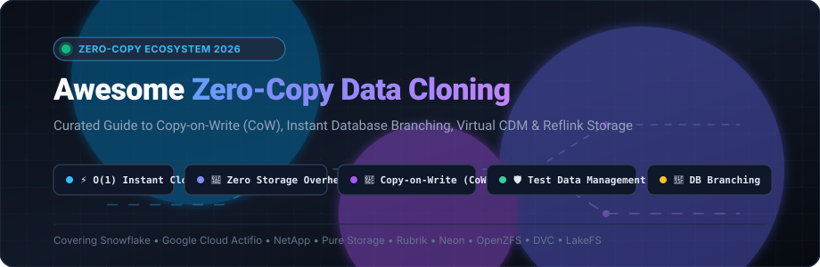

# ⚡ Awesome Zero-Copy Data Cloning

<p align="center">
  
</p>

<p align="center">
  <a href="https://github.com/ishandutta2007/Awesome-Awesome-Awesome"></a>
  <a href="https://discord.gg/jc4xtF58Ve"></a>
  <a href="https://github.com/ishandutta2007/Awesome-Zero-Copy-Data-Cloning/stargazers"></a>
  <a href="https://github.com/ishandutta2007/Awesome-Zero-Copy-Data-Cloning/network/members"></a>
  <a href="https://github.com/ishandutta2007/Awesome-Zero-Copy-Data-Cloning/blob/main/LICENSE"></a>
  <a href="https://github.com/ishandutta2007/Awesome-Zero-Copy-Data-Cloning/commits/main"></a>
  <a href="https://github.com/ishandutta2007/Awesome-Zero-Copy-Data-Cloning/pulls"></a>
  <a href="https://github.com/ishandutta2007"></a>
</p>

---

## 📖 Executive Summary & SEO Overview

**Zero-Copy Data Cloning** (also known as **Copy Data Management / CDM**, **Database Branching**, and **Copy-on-Write / CoW Data Virtualization**) is an architectural paradigm that enables organizations to create instant, space-efficient, isolated copies of databases, file systems, and storage volumes in $O(1)$ time. 

Instead of performing byte-for-byte physical data duplication, zero-copy engines allocate pointer metadata referencing the original blocks. Only incremental modifications (*deltas*) consume physical storage via **Copy-on-Write (CoW)** or **Redirect-on-Write (RoW)**.

### 🎯 Primary Use Cases
- 🧪 **DevOps & CI/CD Testing**: Spin up 100 GB–100 TB staging/ephemeral databases in seconds without duplicating cloud storage bills.
- 🛡️ **Ransomware & Disaster Recovery**: Mount petabyte-scale immutable recovery volumes instantly without lengthy data restoral.
- 🤖 **AI/ML Training & Data Sandboxes**: Branch raw lakehouse partitions and test vector indices without mutating production datasets.
- 🔒 **Test Data Management (TDM) & Compliance**: Enforce automated PII masking on cloned branches before exposing data to engineering teams.

---

## 📑 Table of Contents
- [🌐 Sector Overview & Market Dynamics](#-sector-overview--market-dynamics)
- [🏢 SaaS & Enterprise Platforms](#-saas--enterprise-platforms)
- [💻 Open-Source GitHub Projects](#-open-source-github-projects)
  - [🗄️ Database Branching & Orchestration Platforms](#️-database-branching--orchestration-platforms)
  - [📁 Filesystems, Reflinks & Storage Engines](#-filesystems-reflinks--storage-engines)
  - [🌊 Data Lakes & Versioned Object Storage](#-data-lakes--versioned-object-storage)
  - [🧩 Libraries, Bindings & System Primitives](#-libraries-bindings--system-primitives)
- [🔍 Architectural Gap Analysis](#-architectural-gap-analysis)
- [🤝 How to Contribute](#-how-to-contribute)
- [💖 Support & Sponsorship](#-support--sponsorship)
- [📈 Star History](#-star-history)
- [⚖️ Disclaimer & License](#️-disclaimer--license)

---

## 🌐 Sector Overview & Market Dynamics

The global **Copy Data Management (CDM) and Data Virtualization market** is estimated at **$4.8 billion in 2026** and projected to exceed **$12.5 billion by 2032**, expanding at a compound annual growth rate (**CAGR of ~17.2%**), propelled by surging enterprise demand for instant CI/CD test database environments, AI sandbox training, and rapid ransomware disaster recovery.

Market concentration exhibits a dual dynamic:
- **Infrastructure & Enterprise Storage Layer**: **Moderately concentrated / oligopolistic**, dominated by established infrastructure incumbents (Google Cloud/Actifio, NetApp, Pure Storage, Snowflake, Nutanix, Rubrik, and Cohesity) who maintain high defensibility through deep hypervisor integration, enterprise appliance lock-in, and compliance moats.
- **Developer-Facing & Database Branching Layer**: **Rapidly fragmenting**, driven by cloud-native serverless databases and open-source file primitives (Neon, Bytebase, Database Lab Engine, LakeFS) delivering frictionless, API-driven $O(1)$ clones for ephemeral developer workflows.

---

## 🏢 SaaS & Enterprise Platforms

The table below catalogs leading commercial SaaS, cloud-native, and appliance platforms offering zero-copy cloning, sorted descending by **company scale (valuation or market capitalization)**.

| 🏢 Platform / Product | 📊 Company Scale (Valuation / Revenue) | 🏷️ Starting Pricing | 🎁 Free Tier / Trial Limits | ⚡ Key Zero-Copy Capabilities |
| :--- | :--- | :--- | :--- | :--- |
| **[Google Cloud Actifio](https://cloud.google.com/actifio)** (Backup & DR) | **Market Cap: ~$2.14T**<br>(Alphabet / Cloud ARR: ~$36B) | **$0.03/GiB-month** of protected data + $0.02/GB/mo storage | **90-Day Free Trial** with **$300 cloud credits** valid across all GCP services | Enterprise CDM virtualizing SAP HANA, Oracle, SQL Server, and VMware; instant mount without data hydration. |
| **[Snowflake Zero-Copy Clone](https://docs.snowflake.com/en/user-guide/object-clone)** | **Market Cap: ~$52.0B**<br>(Annual Rev: ~$3.6B) | **$2.00/credit** (Standard Tier) + $23/TB-month storage | **30-Day Free Trial** with **$400 in free usage credits** | Native metadata-only cloning of tables, schemas, and whole databases; $0 extra storage cost until cloned rows are modified. |
| **[NetApp SnapMirror & FlexClone](https://www.netapp.com/)** | **Market Cap: ~$28.0B**<br>(Annual Rev: ~$6.3B) | **$0.10/GB-month** (Cloud Backup PayGO) or ONTAP One from ~$1,500/yr | **Free Forever** for Cloud Volumes ONTAP up to **500 GiB provisioned capacity**; 30-day trial for enterprise | Block-level writable pointer FlexClone volumes sharing underlying physical blocks; instant snapshotting at hardware scale. |
| **[Pure Storage FlashRecover](https://www.purestorage.com/)** | **Market Cap: ~$18.0B**<br>(Annual Rev: ~$2.8B) | **$0.046/GB-month** via Evergreen//One (~$3,200/mo min commitment) | **30-Day Free Trial** of Pure Cloud Block Store with up to **10 TB capacity** | Hardware-accelerated thin provisioning, immutable SafeMode snapshots, and instantaneous zero-overhead volume clones. |
| **[Nutanix NDB](https://www.nutanix.com/)** (formerly Era) | **Market Cap: ~$16.0B**<br>(Annual Rev: ~$2.1B) | **$300/database core/year** (~$25/core/month) on Nutanix Cloud | **30-Day Free Test Drive** with multi-engine hosted hands-on lab sandbox | Time Machine zero-byte copy-data management and 1-click clone automation for PostgreSQL, Oracle, SQL Server, and MySQL. |
| **[Rubrik Security Cloud](https://www.rubrik.com/)** | **Market Cap: ~$8.5B**<br>(Annual Rev: ~$700M+) | **$350/workload/year** (~$29.17/workload/month subscription) | **30-Day Free Trial** with full SaaS platform access for up to **10 VMs or 1 TB data** | Zero-copy Live Mount for instant ransomware recovery, test/dev spinning, and automated sensitive data discovery. |
| **[Cohesity Data Cloud](https://www.cohesity.com/)** | **Valuation: ~$7.0B**<br>(Combined Rev: ~$1.6B post-Veritas) | **$250/TB/year** (~$20.83/TB/month on AWS/Azure Marketplace) | **30-Day Free Trial** with up to **5 TB protected cloud backup capacity** | SpanFS zero-cost space-efficient writable clones, mass restore of petabytes in minutes, and unified multi-cloud CDM. |
| **[Delphix Continuous Data](https://www.delphix.com/)** (Perforce) | **Parent Valuation: ~$2.5B**<br>(Delphix Rev: ~$120M) | **$1,500/vCPU/year** (Enterprise starter deployments from ~$50,000/year) | **14-Day Guided Sandbox Trial** with up to **2 virtual DB targets (1 TB footprint)** | Comprehensive database virtualization and integrated PII masking engine for Oracle, SAP HANA, SQL Server, and Postgres. |
| **[Neon Serverless Postgres](https://neon.tech/)** | **Valuation: ~$1.0B**<br>(Series B Unicorn) | **$19/month** (Launch Plan) or **$0.16/compute hour** | **Free Forever Plan**: 0.5 GiB storage, 1 project, 10 active branches, 100 compute hrs/mo | Page-level copy-on-write database branching in under 1 second; instant isolated dev environments from prod snapshots. |
| **[Redgate SQL Clone](https://www.redgate.com/products/sql-clone/)** | **Valuation: ~$600M**<br>(Annual Rev: ~$100M) | **$1,200/SQL Server instance/year** (~$100/instance/month) | **14-Day Fully-Featured Free Trial** with unlimited clones and image creation | Creates full SQL Server virtual databases in seconds using 2 MB local differential VHD virtual disks. |
| **[K2View Data Product Platform](https://www.k2view.com/)** | **Valuation: ~$300M**<br>(Annual Rev: ~$50M) | **$2,500/month** base enterprise SaaS subscription | **30-Day Free Sandbox Trial** with up to **10,000 business micro-databases** | Micro-database architecture isolating individual customer entities; instant virtualized masking and synthetic data cloning. |

---

## 💻 Open-Source GitHub Projects

Explore the leading open-source repositories powering zero-copy clones, copy-on-write filesystems, and data virtualization. **Sorted descending by GitHub star count**.

### 🗄️ Database Branching & Orchestration Platforms

1. **[Neon](https://github.com/neondatabase/neon)** [](https://github.com/neondatabase/neon/stargazers)  
   *Architecture*: Rust & C • *License*: Apache-2.0  
   Open-source serverless PostgreSQL engine that separates compute and storage. Implements a custom multi-tenant storage engine (`safekeeper` + `pageserver`) that supports **instant page-level copy-on-write database branching**. Allows spinning up thousands of independent, fully-isolated PostgreSQL clones in milliseconds without duplicating storage.

2. **[Bytebase](https://github.com/bytebase/bytebase)** [](https://github.com/bytebase/bytebase/stargazers)  
   *Architecture*: Go & TypeScript • *License*: Apache-2.0  
   Database CI/CD and DevOps collaboration tool for developers and DBAs. Features automated schema migration, data masking, and instant database branch cloning workflows for PostgreSQL, MySQL, ClickHouse, and Snowflake.

3. **[Database Lab Engine](https://github.com/postgres-ai/database-lab-engine)** [](https://github.com/postgres-ai/database-lab-engine/stargazers)  
   *Architecture*: Go • *License*: AGPL-3.0  
   Open-source technology for thin cloning of PostgreSQL databases of any size in tens of seconds. Built on top of ZFS or AWS EBS volume snapshots; orchestrates thin database clones inside Docker containers for non-production testing, verification of schema migrations, and SQL query tuning without extra storage costs.

4. **[pgclone](https://github.com/valehdba/pgclone)** [](https://github.com/valehdba/pgclone/stargazers)  
   *Architecture*: C & PL/pgSQL • *License*: PostgreSQL License  
   Native PostgreSQL extension for in-database zero-copy schema and table cloning without invoking `pg_dump` or `pg_restore`. Features built-in data masking (emails, names, credit cards, phones), parallel background workers, and full DDL support for Postgres 14 through 18.

5. **[StagDB (Community Edition)](https://github.com/abuta-labs/stagdb-ce)** [](https://github.com/abuta-labs/stagdb-ce/stargazers)  
   *Architecture*: Python & Docker • *License*: Open Source  
   Self-hosted web platform orchestrating instant PostgreSQL database clones using Docker and ZFS copy-on-write datasets. Provisions functional clone environments in ~5 seconds with built-in connection string generators and health monitors.

---

### 📁 Filesystems, Reflinks & Storage Engines

1. **[iterative/dvc](https://github.com/iterative/dvc)** [](https://github.com/iterative/dvc/stargazers)  
   *Architecture*: Python • *License*: Apache-2.0  
   Data Version Control (DVC) for machine learning projects. Leverages filesystem-level **zero-copy reflinks (`FICLONE`), hard links, and symlinks** to version multi-gigabyte models and datasets in $O(1)$ time without data duplication.

2. **[JuiceFS](https://github.com/juicedata/juicefs)** [](https://github.com/juicedata/juicefs/stargazers)  
   *Architecture*: Go • *License*: Apache-2.0  
   High-performance POSIX file system built on top of Redis/SQL metadata engines and S3/object storage. Provides atomic, instant zero-copy directory cloning and file snapshots via metadata pointer duplication.

3. **[cubecow (Tencent CubeSandbox)](https://github.com/tencentcloud/cubesandbox)** [](https://github.com/tencentcloud/cubesandbox/stargazers)  
   *Architecture*: Rust • *License*: Apache-2.0  
   Modular Rust storage engine implementing Copy-on-Write (CoW) volume cloning via Linux `FICLONE` / `xfs-reflink`. Offers $O(1)$ space-efficient volume clones, flat snapshot models, and crash-resilient storage primitives.

4. **[OpenZFS](https://github.com/openzfs/zfs)** [](https://github.com/openzfs/zfs/stargazers)  
   *Architecture*: C • *License*: CDDL  
   The foundational enterprise Copy-on-Write storage platform. Features native pointer-based instant snapshots, writable clone datasets (`zfs clone`), block-level deduplication, and transactional data integrity without physical replication overhead.

5. **[Btrfs Progs](https://github.com/kdave/btrfs-progs)** [](https://github.com/kdave/btrfs-progs/stargazers)  
   *Architecture*: C • *License*: GPL-2.0  
   User-space utilities for the Btrfs copy-on-write filesystem. Powers instant subvolume snapshots, `cp --reflink` zero-copy deduplication, and atomic subvolume cloning across modern Linux distributions.

---

### 🌊 Data Lakes & Versioned Object Storage

1. **[lakeFS](https://github.com/treeverse/lakeFS)** [](https://github.com/treeverse/lakeFS/stargazers)  
   *Architecture*: Go • *License*: Apache-2.0  
   Git-like data version control and zero-copy branching for data lakes (Amazon S3, Google Cloud Storage, Azure Blob). Creates isolated test/staging branches containing millions of objects in seconds without duplicating underlying Parquet or Iceberg data files.

2. **[Dremio OSS](https://github.com/dremio/dremio-oss)** [](https://github.com/dremio/dremio-oss/stargazers)  
   *Architecture*: Java & C++ • *License*: Apache-2.0  
   Open-source SQL lakehouse platform offering logical data virtualization and semantic views over heterogeneous data sources without physical ETL duplication.

---

### 🧩 Libraries, Bindings & System Primitives

1. **[go-zfsutils](https://github.com/vansante/go-zfsutils)** [](https://github.com/vansante/go-zfsutils/stargazers)  
   *Architecture*: Go • *License*: MIT  
   Idiomatic Go bindings for programmatic ZFS dataset operations, snapshot lifecycle tracking, and instant thin clone creation (`CloneOptions`).

2. **[vibe-native](https://www.npmjs.com/package/@kexi/vibe-native)**  
   *Architecture*: Rust (napi-rs) & TypeScript • *License*: MIT  
   Cross-platform Node.js native module enabling Copy-on-Write file and directory cloning using APFS `clonefile()` on macOS and Linux `FICLONE` / `Btrfs` reflinks.

---

## 🔍 Architectural Gap Analysis

While open-source projects provide powerful building blocks, a major capability gap remains between open-source tools and commercial CDM suites:

```
┌─────────────────────────────────────────────────────────────┐
│                 Application Layer (Masking, CDM)            │
│  [Delphix / Actifio / Rubrik]  ← Enterprise App Awareness   │
├─────────────────────────────────────────────────────────────┤
│                 Database Engine Layer                       │
│  [Neon / Snowflake / pgclone]  ← SQL-Aware Branching/Clones │
├─────────────────────────────────────────────────────────────┤
│                 Storage & Kernel Layer                      │
│  [OpenZFS / Btrfs / FICLONE]   ← Block-Level Pointer CoW    │
└─────────────────────────────────────────────────────────────┘
```

1. **Application Stack Awareness**: Enterprise commercial engines (Delphix, Actifio) virtualize complex multi-tier enterprise applications (SAP ERP, Oracle RAC, Microsoft Dynamics) with transaction consistency across heterogeneous databases. Open-source solutions are primarily single-database engines (Postgres-only) or raw block filesystems.
2. **Integrated Regulatory Masking**: Commercial solutions execute dynamic, rule-based PII anonymization pipelines in-flight before mounting clones. Open-source tools (with the notable exception of `pgclone`) require custom post-clone scripting.
3. **Data Warehouse Parity**: Snowflake's native metadata-only zero-copy clone across petabyte analytical tables remains largely unmatched in self-hosted open-source analytical warehouses like ClickHouse or Trino.

---

## 🤝 How to Contribute

Contributions, updates, and benchmark additions are enthusiastically welcome!

1. 🍴 **Fork the repository** on GitHub.
2. 🌿 **Create your branch**: `git checkout -b feature/add-new-tool`
3. 📝 **Add or update entries**: Follow the established tabular format, ensuring verified pricing, specific free trial limits, and exact company scale metrics.
4. 🚀 **Submit a Pull Request** with a concise description of your additions.

Please ensure all product descriptions remain factual, vendor-neutral, and link to primary documentation.

---

## 💖 Support & Sponsorship

If you find this curated zero-copy data cloning index helpful for your infrastructure, DevOps pipelines, or architectural research, please consider supporting the project!

- ⭐ **Star this repository** to improve discoverability for fellow engineers.
- 🍴 **Fork and share** with your data platform and infrastructure teams.
- ☕ **Sponsor the Maintainer**: Support ongoing curation, benchmark maintenance, and research via the [GitHub Sponsor Dashboard](https://github.com/sponsors/ishandutta2007).

<p align="center">
  <a href="https://github.com/sponsors/ishandutta2007">
    
  </a>
</p>

---

## 📈 Star History

[](https://star-history.dera.page/#ishandutta2007/Awesome-Zero-Copy-Data-Cloning&type=date&legend=top-left)

---

## ⚖️ Disclaimer & License

- **Disclaimer**: This list is independently curated by the community for educational and research purposes. Product names, logos, and brands are property of their respective owners. Mention of commercial products does not constitute an endorsement.
- Clones that share underlying storage blocks with production environments must always have strict access policies and automated masking applied to prevent sensitive data leakage.
- **License**: Released under the [MIT License](LICENSE).
